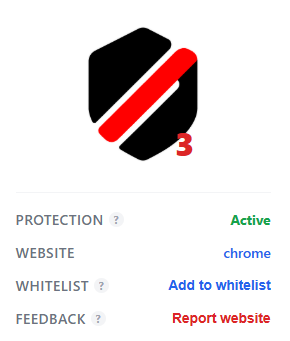
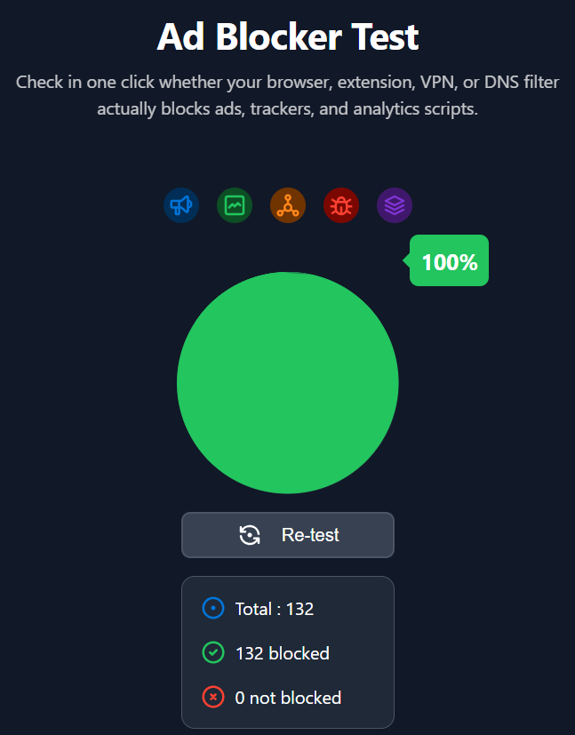
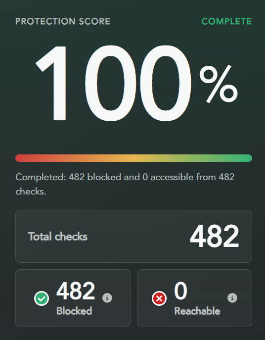
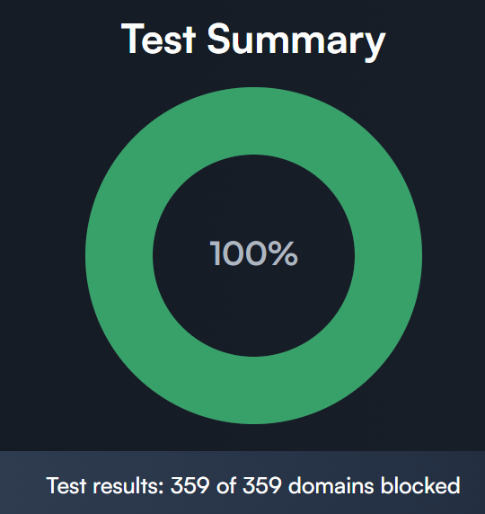

<p align="center">
  
</p>

<h1 align="center">Blockku</h1>
<h3 align="center">Ad and Tracker Blocker</h3>

<p align="center"><em style="font-family: Georgia, serif; font-size: 1.1em; color: #777;">Simple and powerful ad blocker that keeps your browsing fast and ad-free.</em></p>

<p align="center">
  <a href="LICENSE"></a>
  
  
  
  
</p>


> [!CAUTION]
> Video streaming hosts and download pages frequently rotate redirect domains, popunder scripts, and deceptive click traps. While Blockku neutralizes aggressive networks (like Adsterra, revenuecpmgate, and cloudpiko), advertisers introduce new domains daily. Use the **Report website** button in the popup if an ad slips through so it can be added to the filter set.

---

## Preview

<p align="center">
  
</p>

---

## Benchmark Results

Tested and verified on industry-standard ad blocker benchmark suites with a **100% block rate**:

<div align="center">
  <table>
    <tr>
      <td width="33%" align="center">
        <b>TurtleCute / d3ward</b><br><br>
        
        <br><sub>132 of 132 blocked</sub>
      </td>
      <td width="33%" align="center">
        <b>SuperAdblockTest</b><br><br>
        
        <br><sub>482 of 482 blocked</sub>
      </td>
      <td width="33%" align="center">
        <b>Obfusgated</b><br><br>
        
        <br><sub>359 of 359 domains blocked</sub>
      </td>
    </tr>
  </table>
</div>

---

## How Blockku Works

Blockku uses a multi-layered defense model built directly on modern Chromium extension standards:

- **Browser Level Rules (DNR)** — Uses Chrome's native `declarativeNetRequest` engine with 24,500 curated EasyList ad-server and tracker filters. Requests to telemetry servers, tracking beacons, and ad networks are terminated by the browser before any network bytes are downloaded.
- **Main-World Script Interceptor** — Operates directly in the page environment (`world: "MAIN"`) at `document_start`. It intercepts programmatic network requests (`window.fetch`, `XMLHttpRequest`) and neutralizes dynamic `<script>` tag creations (such as Adsterra CPM gates) before page scripts can execute them.
- **Video Ad Neutralizer** — Intercepts media requests, player ad endpoints (like internal `/data/ads/show` APIs), and VAST tags so video players start directly without forced countdowns or pre-roll ads.
- **Popunder & Tab Trap Shield** — Hooks `window.open` and monitors bubbled click events on links to kill background popunders, betting redirects, and unwanted tab spawning.
- **Cosmetic DOM Shield** — Runs an isolated stylesheet and DOM observer that collapses empty banner wrappers and removes floating interstitial ad modals without breaking website layout.

> [!NOTE]
> Everything runs locally in your browser. Blockku does not require an account, has zero analytics, and never transmits your browsing activity to any external server.

---

## Why Blockku

Most popular ad blockers carry over 30,000 to 100,000 legacy filter rules accumulated over a decade. This bloat consumes substantial memory and can slow down page rendering.

- **Zero Bloat & Fast Cold Start** — Written in pure vanilla JavaScript, CSS, and native DNR rules with no build tools, npm packages, or background worker memory leaks.
- **Real-World Streaming Defense** — Tested not only on benchmarks, but specifically fine-tuned against aggressive streaming adware and video prerolls on sites like `animeinweb.com`.
- **Per-Site Whitelist** — Pause blocking on banking, academic, or trusted sites with a single click on **Add to whitelist** without disabling your global ad blocker.
- **Clean & Unobtrusive UI** — Minimal white popup featuring a click-to-toggle logo, live blocked counter, active website details, and an inline issue reporting system.

> [!IMPORTANT]
> When testing rule updates or developing locally, remember to click the **Reload** button on the extension card in `chrome://extensions` and hard refresh target pages with **Ctrl + Shift + R**.

---

## Installation

Works on all modern Chromium desktop browsers including **Google Chrome**, **Brave**, **Microsoft Edge**, **Opera**, and **Vivaldi**.

### Step-by-Step Installation

1. **Download or Clone the Repository**:
   - Clone via Git:
     ```bash
     git clone https://github.com/norvramis/Blockku.git
     ```
   - Or click **Code → Download ZIP** on GitHub and extract the folder to your computer.

2. **Open Extensions Management**:
   - Navigate to `chrome://extensions/` in your address bar (or `brave://extensions/` on Brave, `edge://extensions/` on Edge).

3. **Enable Developer Mode**:
   - Locate the **Developer mode** toggle in the top-right corner and turn it **ON**.

4. **Load the Extension**:
   - Click the **Load unpacked** button in the top-left menu.
   - Select the `Blockku` root directory (the folder containing `manifest.json`).

5. **Pin to Toolbar**:
   - Click the puzzle icon in your browser toolbar and pin **Blockku** for quick access.
   - Click the icon to view the popup interface and confirm the status is **Active**.

---

## Project Structure

```
Blockku/
  ├── manifest.json       # Manifest V3 extension configuration and permissions
  ├── rules.json          # Static Declarative Net Request (DNR) rule definitions
  ├── icon.png            # Master branding icon
  ├── AGENTS.md           # Context and execution guidance for automated coding agents
  ├── CLAUDE.md           # Architectural notes and development workflow
  ├── LICENSE             # Full GNU General Public License v3.0
  ├── assets/             # Brand logos, benchmarks, and toolbar icons
  │     ├── icons/        # Multi-resolution toolbar icons (active & off)
  │     ├── blockku.png
  │     ├── banner.png
  │     └── preview.png
  └── src/
        ├── background/   # Service worker handling DNR state and badge/icon
        │     └── service-worker.js
        ├── content/      # Isolated DOM shield and main-world injector
        │     ├── injector.js
        │     ├── content.js
        │     └── cosmetic.css
        └── popup/        # Popup UI, stylesheet, and optimistic toggle
              ├── popup.html
              ├── popup.css
              └── popup.js
```

---

## Contributing

Contributions are welcome! Whether it's adding new ad-serving domains, reporting unblocked video ads, or improving cosmetic selectors:

1. Fork the repository.
2. Create your feature branch (`git checkout -b feature/new-filter`).
3. Commit your changes (`git commit -m "feat: block aggressive popunder on domain.com"`).
4. Push to the branch (`git push origin feature/new-filter`).
5. Open a Pull Request.

---

## Contributors

<a href="https://github.com/norvramis/Blockku/graphs/contributors">
  
</a>

---

## License

Blockku is free, copyleft open-source software licensed under the [GNU General Public License v3.0 (GPL-3.0)](LICENSE). Any modifications and distributions must remain open source under the same license.
